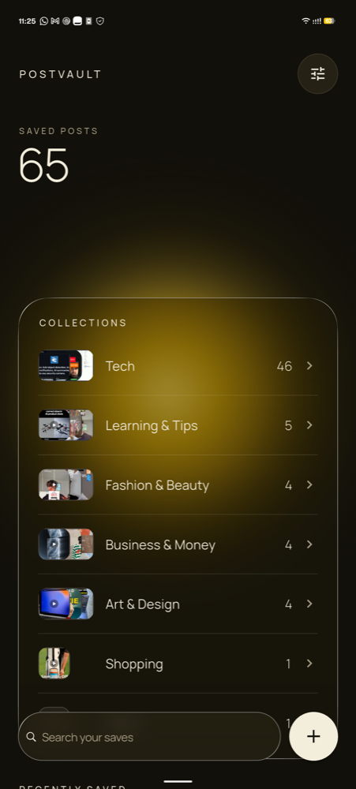
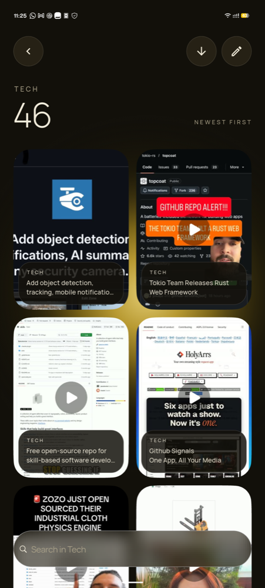
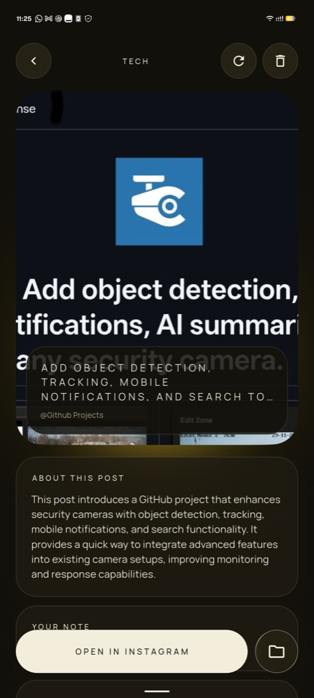
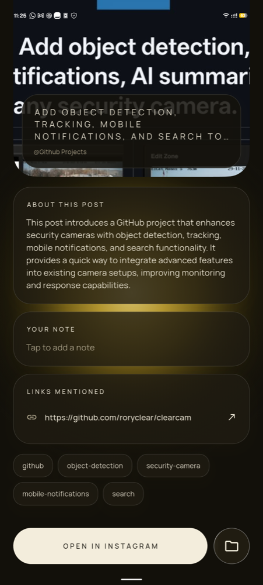
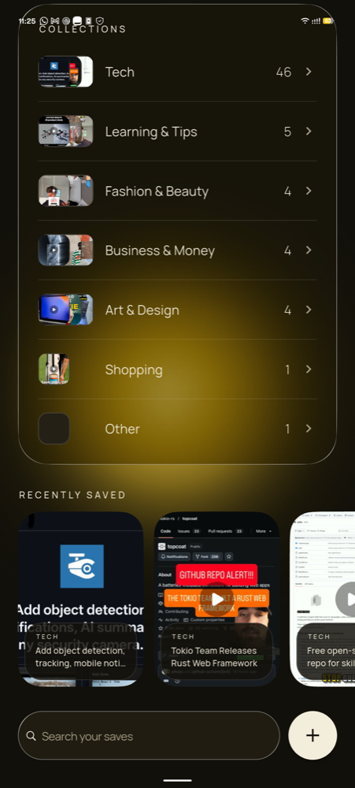
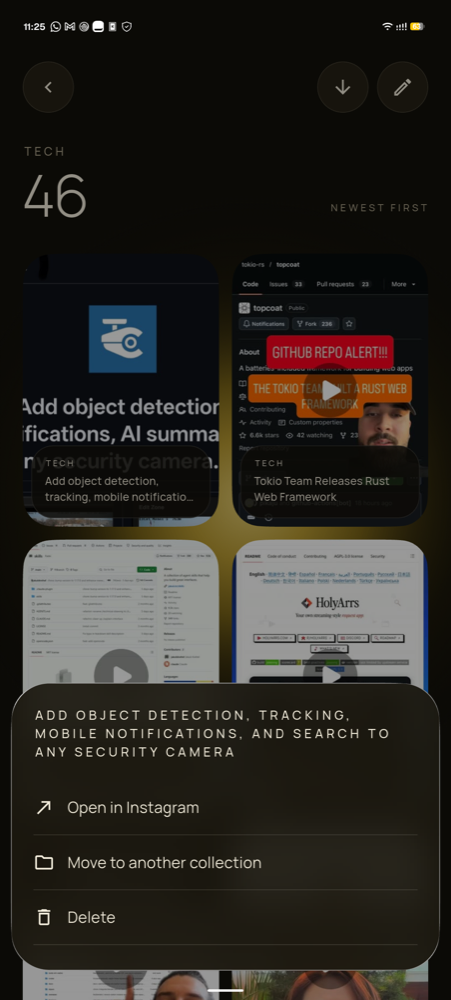
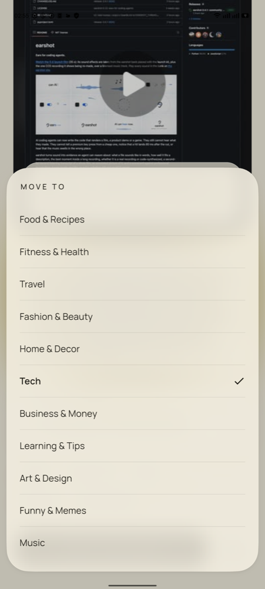
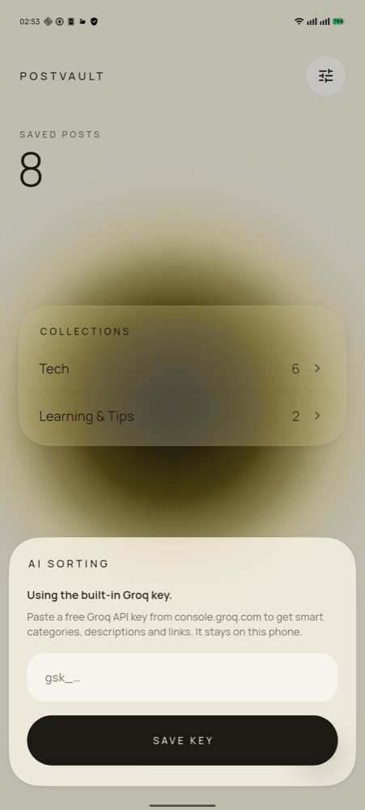

<div align="center">


# PostVault

**Your Instagram saves, sorted and searchable.**

Share any Instagram post to PostVault. AI files it into a collection, writes a short description,
pulls out every link it mentions, and makes it searchable by keyword.

[](https://github.com/Asta39/postvault/releases/latest)


</div>

---

<p align="center">
  
  
  
  
</p>

## Why

Instagram's Saved tab turns into a pile fast. Collections are manual, and there is no way to search
what you saved. PostVault keeps your saves in one place, sorted for you, and lets you find a post
again by typing what it was about.

## Features

- **Save from the share sheet.** Tap **Share → PostVault** on an Instagram, TikTok, YouTube or X post, or paste a link with **+**. PostVault saves it and returns you to the app you were in.
- **Automatic collections.** Each post is sorted into a category such as Food & Recipes, Fitness, Travel or Tech. Create and rename your own collections; the AI sorts into those too.
- **AI description.** A two to three sentence summary of what the post is about and its key takeaway.
- **Links, extracted.** Websites, URLs, tools and @accounts mentioned in the caption, one tap to open.
- **Your notes.** Add a note to any post to remember why you saved it.
- **Search everything.** Search all saves from home or inside one collection, tap a tag to search it, and sort newest or oldest first.
- **Quick actions.** Long-press a post to open, move or delete it. Deletes can be undone.
- **Pictures kept on the phone.** Thumbnails are stored locally, so they keep working after Instagram's links expire.
- **Backup.** Export every post and picture to one file, and import it on another phone.
- **Light and dark.** A cream and gold liquid-glass interface that follows the phone's theme and scales across phone and tablet sizes.
- **Private by default.** Posts are stored on the device in SQLite. There is no account and no server.

<p align="center">
  
  
  
  
</p>

## Install

1. Download `postvault-v1.2.0.apk` from the [latest release](https://github.com/Asta39/postvault/releases/latest).
2. Open it on your Android phone and allow installing from this source when asked.
3. Open Instagram, tap **Share** on a post, and choose **PostVault**.

**Updating from v1.1.0 or older:** v1.2.0 is signed with a new permanent key, so Android will not install it over an older version. In the old app open **Settings → Backup → Export** first, uninstall it, install v1.2.0, then **Import** the backup. This is a one-time step.

Requires Android 7.0 (API 24) or newer.

### Turn on AI sorting

The release build ships **without** an API key. Without one, PostVault still works and sorts posts
by keywords and hashtags. For smart categories, descriptions and link extraction:

1. Create a free key at [console.groq.com](https://console.groq.com/keys).
2. In PostVault tap the **settings** button on the home screen and paste the key.

The key is kept in Android's encrypted storage on your phone and is only sent to Groq.

## How it works

```
Instagram / TikTok / YouTube / X ──Share──▶ PostVault
                       │
                       ├─ fetch the post's preview (caption, author, image)
                       ├─ keep a copy of the image on the device
                       ├─ Groq (openai/gpt-oss-20b) → category, tags, title,
                       │                              description, links
                       │      └─ offline keyword fallback if no key / no network
                       └─ store in SQLite on the device ──▶ browse & search
```

| Area | Where |
|---|---|
| Screens | [`lib/main.dart`](lib/main.dart), [`lib/ui/category_page.dart`](lib/ui/category_page.dart), [`lib/ui/post_detail.dart`](lib/ui/post_detail.dart) |
| Theme, glass presets, responsive sizing | [`lib/ui/cream.dart`](lib/ui/cream.dart) |
| AI categorising and link extraction | [`lib/services/categorizer.dart`](lib/services/categorizer.dart) |
| Post preview scraping | [`lib/services/metadata.dart`](lib/services/metadata.dart) |
| Storage and search | [`lib/data/post_db.dart`](lib/data/post_db.dart) |
| Stored images and backup | [`lib/services/image_store.dart`](lib/services/image_store.dart), [`lib/services/backup.dart`](lib/services/backup.dart) |

Built with [Flutter](https://flutter.dev),
[liquid_glass_widgets](https://pub.dev/packages/liquid_glass_widgets),
[receive_sharing_intent](https://pub.dev/packages/receive_sharing_intent),
[sqflite](https://pub.dev/packages/sqflite) and the [Groq API](https://console.groq.com/docs).

## Build from source

```bash
git clone https://github.com/Asta39/postvault.git
cd postvault
flutter pub get
flutter test
flutter build apk --release
```

To bake a key into your own build (never publish an APK built this way):

```bash
cp secrets.example.json secrets.json   # then put your key in it
flutter build apk --release --dart-define-from-file=secrets.json
```

`secrets.json` is git-ignored.

## Limitations

- Instagram has no API for saved posts, so posts come in through the share sheet one at a time.
- Captions and images come from the post's public link preview. Private accounts, and posts Instagram
  refuses to preview, are saved as a link and sorted as "Other".
- TikTok, YouTube and X saves rely on each site's public link preview and are less tested than Instagram.
- Android only for now.

## License

[MIT](LICENSE)
